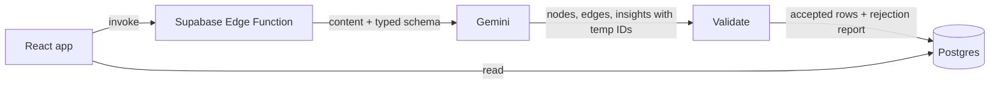

# CognitiveRadar

**See the structure of thinking.** CognitiveRadar turns unstructured content (pasted text, a YouTube video, an uploaded file or a voice recording) into an interactive knowledge graph of the *reasoning* inside it: claims, the evidence behind them, and the assumptions nobody stated.

I think and remember in mind maps, and transcripts and summaries never matched that. This is the tool I wanted.


## What it does

1. You provide content. Gemini reads it and fills in a **typed schema** (forced function calling, so it can't reply in free text):
   - **6 node types:** concept, claim, assumption, evidence, question, contradiction
   - **4 relations:** supports, contradicts, depends_on, example_of
   - **Insights:** gaps, contradictions, hidden assumptions, open questions, each rated by severity
2. The output is **validated before it's stored** (see below), then saved to Postgres.
3. The dashboard draws a force-directed graph. Click a node to see its connections; click an insight to highlight the nodes it's about.
4. **Deep Analysis** sends the saved graph back to Gemini for a second pass: circular reasoning, fallacies, unsupported claims, weak evidence.

## How it works



### Validating model output

Model output is treated as untrusted until checked. The model invents temporary IDs (`n1`, `n2`, ...) so edges can refer to nodes that don't exist yet. `supabase/functions/_shared/save-graph.ts` then:

- gives each valid node its own UUID and resolves every reference through an exact lookup table, not by row order;
- **rejects** nodes with types outside the schema, edges that point at nodes the model never created, and invalid relations;
- strips insight references to unknown nodes;
- checks every insert, and removes the session if any step fails, so there are no half-saved graphs;
- stores a **validation report** on the session. The dashboard shows it as a badge (received / saved / rejected, and whether the input was truncated).

Deep Analysis works the same way: nodes are sent with short IDs, and only IDs from that list are accepted back.

## Inputs

| Input | What the model actually receives |
|---|---|
| Pasted text | The text |
| YouTube link | The video itself, as a Gemini `fileData` part (public videos only). The "transcript" panel shows a model-written summary and is labelled as such |
| PDF | The PDF (Gemini extracts the text) |
| Audio / MP4 / mic recording | The file; Gemini transcribes the **speech**, then the transcript is analyzed. Visual content of uploaded MP4s is not analyzed |
| txt / md / csv | The text |

Long inputs: the first 15,000 characters of uploads and recordings are analyzed, and the validation badge says so when this happens. PDF and media files must be under 14 MB.

## Tech stack

- **Frontend:** React 18, TypeScript, Vite, Tailwind, shadcn/ui, react-force-graph-2d, framer-motion
- **Backend:** Supabase Edge Functions (Deno), Postgres, Storage
- **Model:** Google Gemini via REST (`generateContent`, forced function calling); model set by the `GEMINI_MODEL` secret

## Run it yourself

Requires Node 18+ and a Supabase project.

```bash
npm install

# Backend
npx supabase login
npx supabase link --project-ref <your-project-ref>
npx supabase db push                       # applies supabase/migrations
npx supabase secrets set GOOGLE_GEMINI_API_KEY=<key> GEMINI_MODEL=<model-id>
npx supabase functions deploy --use-api    # deploys all 5 functions (no Docker needed)

# Frontend
cp .env.example .env                       # fill in URL + anon key from Project Settings → API
npm run dev                                # http://localhost:8080
```

Pick `GEMINI_MODEL` from the [current Gemini model list](https://ai.google.dev/gemini-api/docs/models). Set it explicitly; the code's fallback (`gemini-2.5-flash`) may be retired. Use the project's legacy `anon` key (a JWT) in `.env`: the newer `sb_publishable_...` keys aren't JWTs and fail the functions' default auth check with a 401.

## Tests

```bash
npm test                                   # frontend: support counting (Vitest)
deno test supabase/functions/_shared/      # backend: validation + base64 encoding
npm run lint                               # ESLint for the frontend (edge functions use Deno's checker)
```

- `save-graph.test.ts` covers rejected references, schema violations and the cleanup when an insert fails.
- `base64.test.ts` round-trips a 5 MB buffer (the old one-liner crashed above ~500 KB).
- `support.test.ts` checks the node panel's status (backed / reasoned / contested / unsupported) is counted from the graph, not taken from the model.

## Project structure

```
src/
  pages/              Landing, NewSession (input), Dashboard (graph), Sessions
  components/         KnowledgeGraph, NodeDetailPanel, ValidationBadge, ui/ (shadcn primitives in use)
  lib/api.ts          All calls to Supabase
  lib/support.ts      Counts evidence / reasons / challenges for a node
supabase/
  functions/
    _shared/          gemini.ts (API client), ontology.ts (type definitions), save-graph.ts (validation + save), base64.ts
    analyze-text/  analyze-youtube/  analyze-upload/  transcribe-audio/  thinking-engine/
  migrations/         Schema, enums, storage bucket, access policies
```

## Status and limitations

This is a working prototype, not a finished product.

- **Batch, not real time.** Each input is analyzed once. A graph that grows live as people speak was the original design and is the main planned feature.
- **No accounts.** All sessions are visible to anyone using the same deployment. The browser can only read and delete; all writes go through the edge functions.
- **No rate limiting** on the Gemini-backed functions yet. Use a spending cap on the API key.
- **Quality is not yet measured.** There is no labelled evaluation set, so extraction accuracy is unknown. Node, relation and insight types are defined in `ontology.ts`, but the model applies them, and does so imperfectly (e.g. a link drawn in the wrong direction).
- **Confidence and severity come from the model.** Each node's confidence is the model's own uncalibrated estimate, so the node panel leads with support counted from the graph and labels the model's number as an estimate. Insight severity (high / medium / low) follows a written rubric the model applies loosely; a code check against the graph's central claim is the planned next step.
- **Light test coverage.** Tests cover validation, encoding and support counting, not the UI end to end.
- **Leftover from the auth experiment:** the migrations still create a `profiles` table and a nullable `sessions.user_id` that nothing uses (see History).

## History

- **v1 (March 2026):** Python/FastAPI + Firestore + Next.js with WebSocket streaming, built phase by phase from a detailed plan. It grew to ~16,000 lines before the parts ran together end to end, and I stopped it. It's still in the git history (up to `059a502`).
- **v2 (April 2026):** rebuilt thin on Supabase, scaffolded with the Lovable AI app builder, to get a working end-to-end baseline. Sign-in was added and rolled back the same day, which is why an unused `profiles` table remains.
- **October 2026:** reviewed the v2 code and fixed what the review found: YouTube was sending the URL as text, so the model never saw the video; edge and insight inserts weren't checked; large files overflowed the call stack; upload policies blocked anonymous users; the API key was sent in the URL; type definitions were missing, so labels drifted; model confidence was shown as if it were measured. Unused template code and dependencies were removed.
- **Next:** a rebuild of the original design in thin, deployed slices, with an evaluation set from the start and the live streaming graph last.
